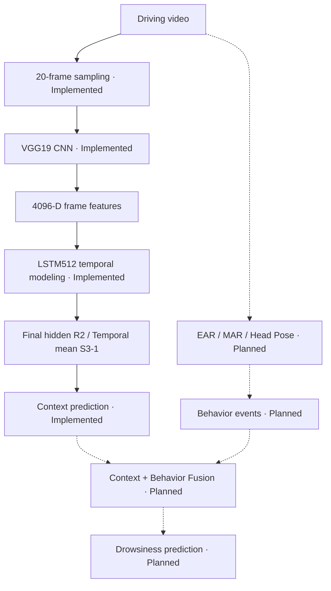

# Driver Drowsiness Detection — CNN-LSTM Context & Behavior Fusion

**Context model research: IN PROGRESS · Behavior/Fusion: PLANNED / NOT STARTED**

실제 운전 영상 데이터셋 논문 **SUST-DDD: A Real-Drive Dataset for Driver Drowsiness Detection**를 바탕으로 VGG19 CNN + LSTM Context 모델을 재구성하는 연구 프로젝트입니다. 공개되지 않은 학습 조건을 명시하고 feature extraction 위치와 CNN fine-tuning 정책을 단계적으로 검토했습니다. 현재는 Context 모델의 temporal readout을 비교하며, 이후 EAR / MAR / Head Pose 행동 신호와 결합하는 Fusion Detection으로 확장할 계획입니다. 기존 Early Drowsiness Detection 논문 재현 경험에서 출발한 후속 연구입니다(이전 프로젝트 내용은 사용자 설명 기준).

**핵심 결과:** R2 Block5 fine-tuning은 R0 대비 **F1 +2.30%p, Recall +4.21%p**를 기록했습니다. Stage2는 COMPLETED이고, Stage3 S3-1은 **2/4 folds 완료 — INTERIM**입니다.

## From Reproduction to Extension

기존 `early-drowsiness-repro` 프로젝트의 blink/EAR temporal feature와 HM-LSTM 기반 조기 졸음 분석 경험을 연구의 출발점으로 삼았습니다(사용자 설명 기준). 이번 프로젝트는 별도 SUST-DDD 논문을 대상으로 운전 영상의 Context를 CNN으로 표현하고 LSTM으로 시간 정보를 모델링합니다. 두 프로젝트를 같은 논문·방법의 구현으로 취급하지 않습니다.

연구 흐름은 **논문 분석 → 데이터 검증 → R0 재구성 → R1 feature point → R2 CNN adaptation·실행 안정화 → R4 duration diagnostic → Stage2 종료 → Stage3 Context improvement**입니다. 상세 과정은 [개발 이력](docs/PROJECT_DEVELOPMENT_HISTORY.md)에 기록했습니다.

## Research Motivation & Pipeline

연구 목표는 한 프레임의 눈 감김 판정을 넘어 영상의 시간 흐름과 명시적인 행동 신호를 함께 다루는 것입니다. Context는 영상 sequence 분류, Behavior는 눈·입·머리 움직임의 event 검출, Fusion은 두 출력의 결합을 담당하도록 계획합니다. Behavior/Fusion의 효과는 아직 미검증입니다.



실선은 구현된 Context 경로, 점선은 향후 경로입니다. Context 구현은 완료했지만 개선 실험은 진행 중입니다. 현재 입력은 영상 전체에서 균일 추출한20 frames로, offline clip 분류 결과를 실시간 조기 경보 성능으로 해석하지 않습니다.

## Current Status

**2026-10-28 기준** 상태입니다. 완료는 각 단계의 명시된 범위에 대한 표현입니다.

| Stage / work | Status |
|---|---|
| Stage1 — Paper-informed reconstruction / R0 VGG19·VGG16 | COMPLETED |
| Stage2 — Reconstruction refinement / R1·R2·R4 diagnostic | COMPLETED |
| Stage3 — Proposed Context Model Improvement / S3-1 | IN PROGRESS · 2 OF 4 FOLDS COMPLETED |
| S3-1 Fold1 / Fold2 | COMPLETED VIA RESUME / COMPLETED VIA RESUME |
| S3-1 Fold3 / Fold4 | NOT RUN / NOT RUN |
| S3-1 official 4-fold aggregate | NOT AVAILABLE |
| Behavior Detection — EAR / MAR / Head Pose | PLANNED / NOT STARTED |
| Context + Behavior Fusion | PLANNED / NOT STARTED |

## Paper-informed Reconstruction

저장소의 [논문 근거 정리](docs/paper_reconstruction/baseline_spec.md)는 세 범주를 구분합니다.

- **Paper-reported:** 실제 운전 영상2,074개(drowsy975 / not drowsy1,099), 10초 clips, 224×224×3 입력, video당20 frames, CNN + one LSTM layer, two FC layers와 final Softmax, VGG16/VGG19 등의 비교, 75/25 train/test와4-fold CV.
- **Structurally inferred:** Figure의 layer dimension과 parameter count로부터 LSTM input4096D / hidden512 구조를 재구성했습니다. Single-bias LSTM의 `4 × 512 × (4096 + 512 + 1) = 9,439,232`에 맞춰 custom LSTM을 구현했습니다.
- **Project-defined conditions:** 균일 frame sampling, ImageNet pretraining/normalization, FC1 after ReLU, freeze/fine-tuning 정책, Adam/LR/batch16/fixed30 epochs/seed42 등을 별도로 명시했습니다.

논문은 정확한 sampling·feature point·pretrain/freeze 정책, optimizer/LR/batch/epochs, scheduler/early stopping, augmentation/normalization/seed 등 세부 조건을 충분히 공개하지 않았습니다. 따라서 이 구현은 **paper-informed reconstruction**이며 원 실험과의 완전한 동일성은 미검증입니다. 공개된 근거와 프로젝트의 선택을 분리해 기록했습니다.

원논문 Table III의 VGG19 F1 91.50%는 참고값입니다. 미공개 조건 때문에 프로젝트 결과와 직접 동등 조건 비교에는 제한이 있으며, 수치 차이를 곧바로 구현의 성공·실패로 해석하지 않습니다.

## Dataset & Evaluation

SUST-DDD2,074 videos에서 동일한 **label-stratified 4-fold / seed42**, video당20 frames, positive class **drowsy**를 사용합니다. Subject-wise 분할 정보는 미확인이며 subject-independent 일반화를 주장하지 않습니다.

Accuracy·Precision·Recall·F1을 보고하되 졸음 누락과 균형을 보기 위해 **Recall과 F1**을 중심으로 해석합니다. Official은 각 fold의 **fixed epoch30 final**이며, aggregate는 **mean ± population std(ddof=0)**입니다. 별도 validation·scheduler·early stopping·best checkpoint selection은 사용하지 않습니다.

Held-out test의 최고 epoch는 **POST-HOC DIAGNOSTIC ONLY**로 분리하고 official model selection에 사용하지 않았습니다. 다만 동일 test 결과를 관찰하며 후속 실험을 설계하므로 Stage3 비교는 exploratory model development이며 독립적인 확증 평가로 주장하지 않습니다.

## Key Results & Experiment Journey

아래는 **완료된 official final-epoch 4-fold** 결과입니다. Mean은 %, std는 %p이며 population std를 사용합니다.

| Condition | Accuracy | Precision | Recall | F1 |
|---|---:|---:|---:|---:|
| R0 — Frozen VGG19 FC1 | 79.94 ± 1.77 | 80.88 ± 3.11 | 75.28 ± 1.67 | 77.94 ± 1.65 |
| R1 — Frozen VGG19 FC2 | 79.51 ± 2.78 | 81.45 ± 2.80 | 73.24 ± 7.05 | 76.91 ± 3.99 |
| R2 — VGG19 Block5 fine-tuning | **81.58 ± 2.19** | **81.04 ± 2.89** | **79.49 ± 2.06** | **80.24 ± 2.22** |

- **R0 — 재구성 reference:** Frozen VGG19의 FC1 after ReLU4096D → LSTM512 → Dense head로 출발했습니다. 비교용 VGG16 baseline도4-fold 완료했으며 F1은77.72%입니다.
- **R1 — Feature point가 원인인가?** FC1→FC2만 변경한 결과 F1은 R0 대비−1.03%p였습니다. 이 조건에서 feature point 변경의 개선은 관찰되지 않아 FC1 reference를 유지했습니다.
- **R2 — CNN adaptation이 도움이 되는가?** Block1~4와 FC1은 frozen으로 두고 Block5를 학습했습니다. R0 대비 Accuracy+1.64%p / Precision+0.17%p / **Recall+4.21%p / F1+2.30%p**였습니다. 이번 비교에서는 feature point 변경보다 representation adaptation이 유리했고, 주된 변화는 Recall 증가였습니다.
- **R4 — 더 짧은 학습이 유리한가?** 완료된 R2 history의 공통 epoch15를 진단했습니다. F1은15epoch **80.03% ± 1.95%p**, official30epoch **80.24% ± 2.22%p**, raw 차이 약−0.22%p였습니다. **DIAGNOSTIC ONLY / MIXED / INCONCLUSIVE**로 기록하고 새 fixed15 학습을 권장하지 않았습니다.
- **Stage2 종료:** R1·R2와 R4 diagnostic을 정리하고 COMPLETED로 범위를 닫았습니다. R3 optimizer/LR는 OPTIONAL / NOT RUN, R5 preprocessing/sampling은 DEFER / NOT RUN입니다.

### Current Research Question — S3-1 Temporal Mean Pooling

**Does aggregating all LSTM timestep representations provide a better context representation than using only the final hidden state?** 기존 R2의 마지막 hidden state 대신20 timestep hidden states를 평균내면 동일 CNN/LSTM/head 조건에서 F1과 Precision/Recall 균형이 달라지는지 검토합니다.

주요 architecture 차이는 `h20 [B,512]` → `[B,20,512].mean(dim=1)`뿐입니다. Parameter 수는 R2와 동일한 **total132,523,778 / trainable19,174,082 / frozen113,349,696**이며 batch16/AMP=false/fixed30과 기존 연구 조건을 유지합니다.

**INTERIM — 2/4 folds.** 아래는 완료된 개별 fold의 epoch30 official metric이며4-fold aggregate는 아직 없습니다.

| S3-1 completed fold | Accuracy | Precision | Recall | F1 | ΔF1 vs same R2 fold |
|---|---:|---:|---:|---:|---:|
| Fold1 — via resume | 78.61% | 78.30% | 75.41% | 76.83% | −0.06%p |
| Fold2 — via resume | 79.96% | 82.11% | 73.36% | 77.49% | −2.35%p |

두 완료 fold에서 R2 대비 Precision 증가·Recall 감소를 관찰했습니다. **2-fold interim F1 mean은77.16% — INTERIM DIAGNOSTIC ONLY / NOT OFFICIAL AGGREGATE**입니다. Fold3·4 이후4-fold mean/std로 판단하며 현재 관찰을 일반화하거나 S3-1의 최종 우열로 결론내리지 않습니다. Raw metrics·paired delta·post-hoc best epoch·resume 이력은 [Stage3 결과](docs/context_model/stage3_context_improvement_plan.md#s3-1-interim-results--24-folds)에 있습니다.

## Problem Solving & Engineering

- **불완전한 논문 명세 → 근거 분류:** Paper-reported / structurally inferred / project-defined 조건을 분리하고 parameter count로4096D 입력과 single-bias LSTM을 검증했습니다.
- **GPU 학습 공급 병목 → profiling:** Workers0의 bounded profile에서 train batch time 중 loading 비중83.12%를 확인해 DataLoader 실행 설정을 조사했습니다. 모델·batch·AMP 조건과 실행 설정 변경을 구분했습니다.
- **짧은 profile과 full-run 안정성의 차이:** Workers2는 반복 대기 문제가 있었고 정확 원인은 미확인입니다. Workers8은 short profile 성공 후 full training의 shared-storage 단계에서 Windows1455 오류로 실패했습니다. Workers4/prefetch1은 resume을 포함해 R2 네 fold final 결과를 확보했으며 최적 설정이나 무중단 완주를 뜻하지 않습니다.
- **장시간 학습 중단 → epoch checkpoint/resume:** Model·optimizer·epoch·history·Python/NumPy/CPU/CUDA RNG·shuffle generator를 복원하도록 구성했습니다. S3-1도 Fold1 epoch20→21, Fold2 epoch25→26에서 재개해30까지 완료했습니다. 무중단 trajectory와의 bitwise 동일성은 미검증입니다.
- **추적 가능한 결과 → MLflow와 로컬 기록:** Condition/fold별 tracking과 history·final metrics·environment를 남겼습니다. R2 Fold4는 final 저장 후 cp949 출력 오류로 MLflow 상태가 RUNNING에 남은 이력을 구분해 보존했습니다.
- **비교 해석 통제:** Best test epoch를 official로 선택하지 않고, S3-1은 parameter 수를 유지해 temporal readout 변경을 비교합니다. 상세 실패 이력과 복구 과정은 [개발 이력](docs/PROJECT_DEVELOPMENT_HISTORY.md)에 있습니다.

## Tech Stack

**Python · PyTorch · Torchvision · OpenCV · NumPy · MLflow · CUDA/cuDNN · PyYAML · pytest**를 사용합니다. 현재 모델은 VGG19/VGG16과 custom single-bias LSTM입니다. EAR/MAR/Head Pose와 Fusion은 향후 구현 대상입니다.

## Repository Structure

핵심 구조입니다. Behavior/Fusion 디렉터리는 현재 placeholder이며 구현 완료를 뜻하지 않습니다.

```text
configs/
  paper_reconstruction/     # R0/R1/R2 실험 조건
  context_model/            # S3-1 실험 조건
  behavior/, fusion/        # 향후 branch 설정 placeholder
docs/
  paper_reconstruction/     # 논문 근거·데이터·모델·결과·refinement
  context_model/            # Stage3 계획과 중간 결과
  PROJECT_DEVELOPMENT_HISTORY.md
scripts/                   # 데이터 준비·학습·profiling CLI
src/drowsiness_fusion/     # data / models / training / evaluation 등
tests/                     # 구조·학습·checkpoint 등 검증
outputs/                   # 로컬 실험 산출물
README.md                  # 프로젝트 소개와 문서 허브
```

## Documentation Index

상세 명세와 실행 정보는 다음 문서에서 확인할 수 있습니다.

- [Baseline specification](docs/paper_reconstruction/baseline_spec.md) — 논문 근거, 구조 추론, 구현 선택과 known unknowns.
- [Data preparation](docs/paper_reconstruction/data_preparation.md) — metadata, split, sampling과 전처리 정책.
- [Model pipeline](docs/paper_reconstruction/model_pipeline.md) — frame→VGG→LSTM 구조와 구현 대응.
- [Baseline results](docs/paper_reconstruction/results.md) — VGG19/VGG16 official 결과와 post-hoc diagnostic.
- [Reconstruction refinement](docs/paper_reconstruction/reconstruction_refinement.md) — R0/R1/R2 비교, 실행 설정과 troubleshooting.
- [R4 duration plan](docs/paper_reconstruction/r4_training_duration_plan.md) — duration 사전 계획과 기존 history 진단.
- [Stage3 Context improvement](docs/context_model/stage3_context_improvement_plan.md) — 고정 연구 조건, S3-1 설계와2/4-fold 중간 결과.
- [Project development history](docs/PROJECT_DEVELOPMENT_HISTORY.md) — 개발·실험·실패·resume 흐름 및 주요 실행 명령.

## Next Steps

1. S3-1 Fold3, 이어서 Fold4를 수행합니다.
2. 동일 fold의 R2와 비교하고4-fold mean/std·Precision/Recall·비용을 함께 검토합니다.
3. S3-1 결과에 근거해 추가 Context architecture 실험 여부를 결정합니다. Attention/BiLSTM/Bottleneck은 현재 미구현 후보입니다.
4. Behavior branch와 Context + Behavior Fusion을 별도로 설계합니다. Event 정의·평가·timestamp 정렬·결합 규칙은 향후 검증 대상입니다.

이 프로젝트는 논문 기반 baseline 재구성에서 출발해, 실험 근거에 따라 Context architecture를 검토하고 영상 Context와 명시적 행동 신호를 결합하는 Fusion Detection까지 확장하는 과정입니다. 현재는 **Context model improvement** 단계이며 Behavior/Fusion은 계획 상태입니다.
