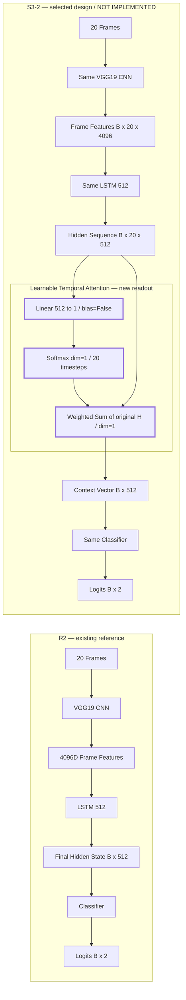
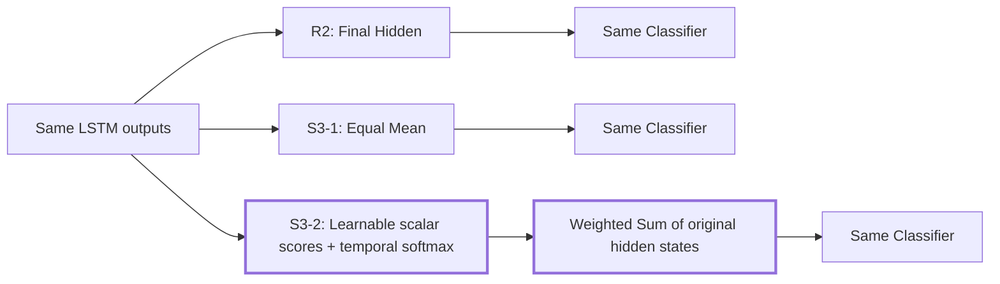

# S3-2 Learnable Temporal Attention — Progress Log

## 1. Architecture Change

**Selected architecture / DESIGN ONLY / NOT IMPLEMENTED.** Learnable Temporal Attention은 **LSTM의 각 시점 표현에 학습 가능한 중요도를 부여한 뒤 가중합하는 시간 정보 결합 방식**이다.



### What changed?

- **R2:** 20 frames를 처리한 LSTM의 마지막 시점 hidden representation만 분류에 사용했다.
- **S3-1:** 20개 시점 표현을 동일한 비중0.05로 평균했다.
- **S3-2 선택 설계:** 같은 VGG19·LSTM·classifier를 유지하고 각 hidden state에서 scalar score를 계산한 뒤, sample별 중요도로 원래 hidden states를 가중합할 계획이다. 새로운 부분은 굵은 테두리의 Attention 시간 정보 결합부뿐이다.

현재는 **설계 명세**이며 아직 적용·구현·학습하지 않았다. 기존 head는 별도 reusable module이 아니라 명시적 fc1/ReLU/fc2/Sigmoid/fc3 호출이다. 같은 구조와 초기화 순서를 유지할 계획이며 기존 head를 새로 개선하지 않는다. 기본 forward 출력은 Tensor logits `[B,2]`다.



차이는 시간 정보 결합 방식(temporal readout)이다. `score = w^T h_t`, `alpha = softmax(score, dim=1)`, `context = sum(alpha * H, dim=1)`로 설계했다. Alpha `[B,20,1]`는 입력 sequence마다 계산되며 고정된20개 전역 위치 parameter가 아니다. 가중치가 높은 timestep은 representation 구성에 상대적으로 크게 반영됐다는 뜻이며, 특정 frame이 졸음의 원인이라는 뜻은 아니다.

**Shape 계약:** `[B,20,3,224,224] → [B,20,4096] → [B,20,512] → score/alpha [B,20,1] → weighted hidden [B,20,512] → context [B,512] → logits [B,2]`. Weight `[1,512]`만 추가할 계획이다. 세부 후보 비교·gradient·optimizer·검증 계획은 [선택 설계](s3_2_attention_plan.md#5-selected-architecture--direct-scalar-temporal-attention)에 있다.

## 2. Why S3-2

[확실] 연구 흐름은 **R2 마지막 timestep 사용 → S3-1 전체 timestep 동일 가중치 평균 → R2 대비 official mean F1 약−2.98%p → 시점별 중요도를 학습하는 방식 검토**다. [S3-1 최종 결과](stage3_context_improvement_plan.md#s3-1-final-results--44-folds)는 해당 architecture/dataset/training 조건에서 NO IMPROVEMENT OVER R2 REFERENCE로 정리됐다.

[추측] **HYPOTHESIS — 미검증 가설:** 모든 timestep이 졸음 판별에 똑같이 중요하지 않을 수 있고, 단순 평균 과정에서 중요한 temporal signal이 다른 정보와 섞여 희석됐을 가능성이 있다. 이를 증명된 원인으로 취급하지 않는다. S3-2에서는 각 timestep의 중요도를 모델이 학습하게 하면 표현이 개선되는지 검토할 예정이다. 이번에 Direct Scalar Attention 설계를 선택했으며 개선 효과는 여전히 미검증이다.

## 3. Starting Conditions

[확실] 문서 체계 시작일: **2026-11-05 KST**. 이 문서는 **실제로 무엇을 했는가**를 기록한다. 앞으로 할 일과 통제 조건은 [실험 계획](s3_2_attention_plan.md)이 담당하고, 아래 Timeline에는 실제 작업을 수행한 순서대로 누적할 예정이다.

| Reference | Official epoch30 F1 mean ± population std(ddof=0) |
|---|---:|
| R2 / S3-0 | 80.24% ± 2.22%p |
| S3-1 | 77.26% ± 0.26%p |
| S3-1−R2 raw mean delta | −2.982288%p (약−2.98%p) |

위 값은 완료된 reference 결과다. S3-2 결과로 복사하거나 예상 성능으로 해석하지 않는다.

| 항목 | 현재 상태 |
|---|---|
| Stage3 | IN PROGRESS |
| S3-1 / result | COMPLETED / NO IMPROVEMENT OVER R2 REFERENCE |
| S3-2 | **ARCHITECTURE DESIGN COMPLETED / DESIGN ONLY** |
| Plan / progress log | CREATED / CREATED |
| Architecture design | **COMPLETED** |
| Implementation / config / trainer integration / test code | NOT STARTED |
| Training | **NOT RUN** |
| Fold1 / Fold2 / Fold3 / Fold4 | NOT RUN / NOT RUN / NOT RUN / NOT RUN |
| Aggregate / actual S3-2 parameter count | NOT AVAILABLE / NOT VERIFIED — expected count는 상세 설계 참고 |
| S3-2 MLflow run / checkpoint | NOT CREATED / NOT CREATED |
| Next | **S3-2 Implementation — NOT STARTED** |

## 4. Progress Timeline

### Step 0 — S3-2 Documentation Setup

- **Date:** 2026-11-05 KST.
- **Status:** COMPLETED.
- **Purpose:** S3-2 연구 질문·비교 기준과 실제 작업을 순서대로 남기는 문서 체계를 먼저 마련한다.
- **Performed / Changes:** `docs/context_model/s3_2_attention_plan.md`와 이 진행 기록을 생성했다. R2와의 개념 구조 비교, R2/S3-1 reference metric, 진행 기록 규칙을 작성했다. `README.md`와 `stage3_context_improvement_plan.md`는 S3-2의 PLANNING 상태와 두 문서 링크를 최소 범위로 갱신했다.
- **Code changes:** NONE. Model/trainer/config/training script/test code를 생성·수정하지 않았다.
- **Validation:** R2/S3-1의 기존 raw final metric에서 F1 mean/std(ddof=0)와 delta를 다시 계산해 reference 값과 일치함을 확인했다. 두 문서의 필수 section 순서, 개념 다이어그램 연결·Attention에만 적용한 스타일, 미결정 항목, 상태, 기록 규칙, 링크·표·UTF-8·공백을 점검했다. Mermaid는 소스 구조를 점검했으며 화면 렌더링은 검증하지 않았다. `git diff --check`와 기존 README/Stage3 문서의 최소 변경 범위를 확인했다.
- **Training:** NOT RUN. S3-2 MLflow run과 checkpoint를 생성하지 않았다.
- **Result:** Documentation baseline established. 계획과 실제 진행 기록을 분리하고 Attention 내부 구조와 parameter 수는 미결정으로 남겼다.
- **Issue:** NONE.
- **Decision:** S3-2는 PLANNING이며 Architecture design/implementation은 NOT STARTED로 기록한다.
- **Next:** S3-2 Architecture Design.

### Step 1 — S3-2 Architecture Design

- **Date:** 2026-11-05 KST.
- **Status:** COMPLETED / DESIGN ONLY.
- **Purpose:** 최소 변경으로 learnable temporal weighting을 비교할 구조를 확정한다.
- **Plan Reference:** [중앙 S3-2.1 Architecture Design](../EXECUTION_PLAN.md#s3-21--architecture-design), [상세 선택 설계](s3_2_attention_plan.md#5-selected-architecture--direct-scalar-temporal-attention).
- **Reviewed:** `r2_vgg19_lstm.py`, `stage3_temporal_mean.py`, `paper_lstm.py`, `vgg_feature_extractor.py`, `train_r2_vgg19.py`, `train_stage3_s3_1.py`, `r2_trainer.py`, `r2_dataloader.py`, 기존 R2/S3-1 YAML, `test_stage3_temporal_mean.py`, R2 official environment JSON. 정확한 경로와 확인 사항은 상세 plan의5.1절에 있다. 기존 test는 읽기만 했다.
- **Candidates:** A Direct Scalar Temporal Attention과 B Projected/Additive Attention을 비교했다. A의 bias=True/False도 구분했다.
- **Decision:** **Candidate A / Linear512→1, bias=False → softmax(dim=1) → original hidden weighted sum**을 선택한다. 별도 projection/activation/dropout/temperature는 없다.
- **Reason:** B는 dimension·activation 등 설계 변수와 parameter가 더 많다. Temporal weighting 자체를 분리하기 위해 단순 A를 택했다. 공통 scalar bias는 temporal softmax에서 상쇄돼 표현력을 늘리지 않으므로 제거했다. 더 복잡한 모델이 나쁘다는 결과를 만든 것은 아니다.
- **Tensor Flow:** Features `[B,20,4096]` → LSTM H `[B,20,512]` → score/alpha `[B,20,1]` → weighted H `[B,20,512]` → context `[B,512]` → same classifier logits `[B,2]`.
- **Expected Parameter Change:** 선택안 **+512**. 예상 total **132,524,290** / trainable **19,174,594** / frozen **113,349,696** — **EXPECTED / TO BE VERIFIED AT IMPLEMENTATION**. 표준 `nn.Linear`만 meta에서 세어 bias=False512/bias=True513을 확인했으며 S3-2 actual model count가 아니다.
- **Initialization:** 설치된 Linear의 기본 uniform 초기화를 선택했다. 기존 공통 module 생성 뒤 scorer를 생성할 계획이며 common initial state 비교를 구현 검증에 포함했다. Zero initialization이나 학습된 R2/S3-1 warm-start는 선택하지 않았다.
- **Optimizer Decision:** 기존 iterator는 LSTM/head만 명시해 Attention을 자동 포함하지 않는다. S3-2 전용 `temporal_parameters()`에 scorer를 포함하도록 설계했다. 두 Adam group을 유지하며 Block5 LR0.00001 / LSTM-head-Attention LR0.0001 / weight decay0.00001이다. 기존 R2/S3-1과 trainer는 수정하지 않는다.
- **Gradient / Diagnostic:** FC1 parameter는 frozen이어도 operation을 통한 Block5 gradient를 유지한다. Attention weight도 학습 대상이다. Default Tensor logits를 유지하고 별도 `forward_with_attention()`에서 `(logits, alpha)`를 반환하도록 설계했다. Graph cache/자동 저장은 추가하지 않는다.
- **Validation:** 실제 code의 hidden/head shape, classifier의 명시적 구성, optimizer 누락/중복 검사, config와 effective loader 차이를 확인했다. 설치된 표준 Linear의 meta parameter shape/count 및 기본 초기화 source만 확인했다. S3-2 model/forward/backward/unit test는 만들거나 실행하지 않았다. Shape/expected count·후보 비교·학습/평가 정책·문서 상태·링크/anchor·표·UTF-8·공백과 Mermaid 소스 연결을 점검했다. 기존 Step 0과 S3-1 final 결과 보존을 git HEAD와 대조했다. Mermaid 화면 렌더링은 검증하지 않았다. 전체 `git diff --check`는 통과했고 protected source/config/script/test·기존 output·MLflow DB가 작업 전과 같음을 확인했다.
- **Code Changes:** NONE. Python/YAML/trainer/script/test를 변경하지 않았다.
- **Training:** NOT RUN. MLflow run/checkpoint도 생성하지 않았다.
- **Issues:** 공통 score bias가 redundant하다는 점과 Attention optimizer 누락 위험을 발견해 설계에서 해결했다. R2 YAML workers8/prefetch2와 실제 official workers4/prefetch1을 구분했다. 초기 diff는 기존 테스트 임시 파일 접근 제한으로 재검사했으며 권한 제한 밖의 읽기 전용 검사는 통과했다. 문서 검사에서 post-hoc 정책의 전체 라벨이 빠진 것을 발견해 POST-HOC DIAGNOSTIC ONLY로 보완하고 재검증했다.
- **Plan Change:** 원래 미결정이던 bias/초기화/optimizer/diagnostic을 결정한 것은 예정된 S3-2.1 범위다. 별도 scope 변경은 README/Stage3 상태 동기화 두 문서만 추가한 것이며, 변경 작업 전에 중앙 Plan Change Log에 이유·영향을 기록했다.
- **Result:** **ARCHITECTURE DESIGN COMPLETED**. 선택 설계 명세와 구현 검증 계획 작성. 구현 테스트7개 이상, optimizer coverage/diagnostic parity/common initialization 검증을 계획했으며 실행 결과로 표시하지 않는다.
- **Next:** **S3-2 Implementation — NOT STARTED**.

## 5. Progress Logging Rules

### 각 주요 작업마다 갱신한다

앞으로 Codex가 S3-2 관련 의미 있는 단계를 마칠 때마다 **작업 수행 → 검증 → 이 상세 문서와 [중앙 progress](../PROGRESS.md) 갱신 → 계획 상태/변경 반영 → git diff 확인 → 완료 보고** 순서를 따른다. 코드만 수정하고 끝내지 않으며 진행 기록을 나중에 한꺼번에 작성하지 않는다. 실제 작업 과정과 같은 순서로 누적 기록한다.

기록 대상은 architecture decision, model implementation, config creation, trainer integration, unit/gradient test, parameter count validation, dry run, Fold training start/interruption/resume/completion, metric verification, aggregate calculation, comparison, final decision을 포함한다. 예정된 작업을 실행한 것처럼 쓰지 않는다.

각 entry에는 최소 다음 항목을 기록한다.

```text
### Step N — <단계명>
Date: 실제 작업 날짜, 가능하면 KST 시각과 근거
Status: PLANNED / IN PROGRESS / COMPLETED / BLOCKED
Purpose: 왜 이 작업을 했는가
Changes: 실제 변경한 파일/구조; 없으면 NONE
Validation: 수행한 확인과 결과; 미수행이면 NOT RUN
Result: 실제 결과; 아직 없으면 NOT AVAILABLE
Issue: 발생한 문제; 없으면 NONE
Decision: 결과에 근거한 결정과 미결정 항목
Next: 다음 작업
```

### 실패와 중단을 보존한다

실패한 작업·시도를 삭제하거나 성공 후 숨기지 않는다. Fold가 중단되면 마지막 완료 epoch, 진행 중이던 epoch와 미저장 작업, 원인(미확인이면 UNKNOWN), checkpoint 존재 여부, resume 가능 여부와 확인 근거, 실제 resume 경로와 start_epoch를 기록한다. 아직 재개하지 않았다면 resume 실행은 NOT RUN으로 표시한다.

Checkpoint 복원 뒤 성공하더라도 이전 실패·중단 entry를 유지한다. 완료된 resume output과 이전 부분 실행을 중복 fold로 집계하지 않는다. 실행하지 않은 resume이나 무중단 완주를 만들어 기록하지 않는다.

### 결과 상태를 구분한다

- 실행 전: **NOT RUN / NOT AVAILABLE**. 예상 결과를 만들지 않는다.
- Fold 실행 중 수치: **INTERIM**.
- 네 fold가 완료되지 않은 평균: **INTERIM / NOT OFFICIAL AGGREGATE**.
- 네 fold의 epoch30 final 및 metric 검증 후: **OFFICIAL 4-FOLD RESULT**.
- Best test epoch: **POST-HOC DIAGNOSTIC ONLY**. Official model selection이나 aggregate를 대체하지 않는다.

Raw metric, fold 번호, actual output 경로, official epoch와 집계 방식(mean/population std, ddof=0)을 남긴다. Architecture/parameter count/성능을 실제 검증 전에 확정값으로 적지 않는다.

### 구조와 상태를 함께 갱신한다

Attention 구조를 다음 설계 단계에서 결정하면 맨 위 **Architecture Change**를 결정된 수준까지 갱신한다. 구현 후에는 실제 구현 구조와 맞추고, 설계와 구현이 다른 부분을 구분한다. Step 0의 provisional 블록을 Step 1에서 선택한 scalar scorer/temporal softmax/weighted sum으로 구체화했다. 이후 설계와 실제 구현의 차이가 있으면 이유를 Timeline에 보존한다.

과거 설계 결정·변경 이유는 Timeline에 보존한다. Starting Conditions의 현재 상태와 계획 문서의 Current Status도 실제 진행과 맞추며, 구조 변경이 필요하면 기존 통제 조건에 미치는 영향을 함께 기록한다.
