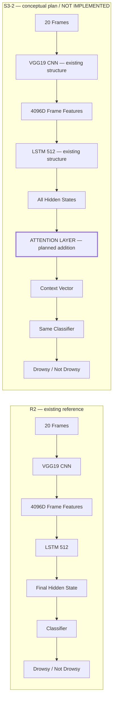

# S3-2 Learnable Temporal Attention — Progress Log

## 1. Architecture Change



R2는 LSTM이20개 프레임을 처리한 뒤 **마지막 timestep의 hidden representation만** 분류에 사용했다. S3-1은20개 timestep hidden representation을 **동일한 비중으로 평균**했다. 이것이 시간 정보 결합 방식(temporal readout)의 차이다.

S3-2에서는 여러 시점 중 어떤 시점이 중요한지를 학습하는 **Learnable Temporal Attention**을 검토한다. 기존 VGG19·LSTM·classifier 구조는 유지하고, **LSTM 출력과 classifier 사이에 Attention layer를 추가할 계획**이다. 전체 CNN/LSTM/head를 새로 만드는 계획이 아니다. 유지 예정인 기존 구조와 추가 예정인 Attention만 구분했으며, 굵은 테두리는 Attention 블록 하나에만 적용했다.

이 다이어그램은 **개념 비교**이며 S3-2는 아직 구현되지 않았다. Attention 내부 구성과 exact parameter count는 미정이다. 상세 구조가 결정되면 이 절을 실제 설계·구현 상태에 맞게 갱신하고, 변경 이유와 이전 결정은 아래 Timeline에 보존할 예정이다. 개념 다이어그램 작성이 Architecture Design 완료를 뜻하지 않는다.

## 2. Why S3-2

[확실] 연구 흐름은 **R2 마지막 timestep 사용 → S3-1 전체 timestep 동일 가중치 평균 → R2 대비 official mean F1 약−2.98%p → 시점별 중요도를 학습하는 방식 검토**다. [S3-1 최종 결과](stage3_context_improvement_plan.md#s3-1-final-results--44-folds)는 해당 architecture/dataset/training 조건에서 NO IMPROVEMENT OVER R2 REFERENCE로 정리됐다.

[추측] **HYPOTHESIS — 미검증 가설:** 모든 timestep이 졸음 판별에 똑같이 중요하지 않을 수 있고, 단순 평균 과정에서 중요한 temporal signal이 다른 정보와 섞여 희석됐을 가능성이 있다. 이를 증명된 원인으로 취급하지 않는다. S3-2에서는 각 timestep의 중요도를 모델이 학습하게 하면 표현이 개선되는지 검토할 예정이다. 아직 Attention 방식이나 개선 효과를 확정하지 않는다.

## 3. Starting Conditions

[확실] 문서 체계 시작일: **2026-11-05 KST**. 이 문서는 **실제로 무엇을 했는가**를 기록한다. 앞으로 할 일과 통제 조건은 [실험 계획](s3_2_attention_plan.md)이 담당하고, 아래 Timeline에는 실제 작업을 수행한 순서대로 누적할 예정이다.

| Reference | Official epoch30 F1 mean ± population std(ddof=0) |
|---|---:|
| R2 / S3-0 | 80.24% ± 2.22%p |
| S3-1 | 77.26% ± 0.26%p |
| S3-1−R2 raw mean delta | −2.982288%p (약−2.98%p) |

위 값은 완료된 reference 결과다. S3-2 결과로 복사하거나 예상 성능으로 해석하지 않는다.

| 항목 | 현재 상태 |
|---|---|
| Stage3 | IN PROGRESS |
| S3-1 / result | COMPLETED / NO IMPROVEMENT OVER R2 REFERENCE |
| S3-2 | **PLANNING** |
| Plan / progress log | CREATED / CREATED |
| Architecture design | **NOT STARTED** |
| Implementation / config / trainer integration / test code | NOT STARTED |
| Training | **NOT RUN** |
| Fold1 / Fold2 / Fold3 / Fold4 | NOT RUN / NOT RUN / NOT RUN / NOT RUN |
| Aggregate / S3-2 parameter count | NOT AVAILABLE / NOT AVAILABLE |
| S3-2 MLflow run / checkpoint | NOT CREATED / NOT CREATED |
| Next | **S3-2 Architecture Design** |

## 4. Progress Timeline

### Step 0 — S3-2 Documentation Setup

- **Date:** 2026-11-05 KST.
- **Status:** COMPLETED.
- **Purpose:** S3-2 연구 질문·비교 기준과 실제 작업을 순서대로 남기는 문서 체계를 먼저 마련한다.
- **Performed / Changes:** `docs/context_model/s3_2_attention_plan.md`와 이 진행 기록을 생성했다. R2와의 개념 구조 비교, R2/S3-1 reference metric, 진행 기록 규칙을 작성했다. `README.md`와 `stage3_context_improvement_plan.md`는 S3-2의 PLANNING 상태와 두 문서 링크를 최소 범위로 갱신했다.
- **Code changes:** NONE. Model/trainer/config/training script/test code를 생성·수정하지 않았다.
- **Validation:** R2/S3-1의 기존 raw final metric에서 F1 mean/std(ddof=0)와 delta를 다시 계산해 reference 값과 일치함을 확인했다. 두 문서의 필수 section 순서, 개념 다이어그램 연결·Attention에만 적용한 스타일, 미결정 항목, 상태, 기록 규칙, 링크·표·UTF-8·공백을 점검했다. Mermaid는 소스 구조를 점검했으며 화면 렌더링은 검증하지 않았다. `git diff --check`와 기존 README/Stage3 문서의 최소 변경 범위를 확인했다.
- **Training:** NOT RUN. S3-2 MLflow run과 checkpoint를 생성하지 않았다.
- **Result:** Documentation baseline established. 계획과 실제 진행 기록을 분리하고 Attention 내부 구조와 parameter 수는 미결정으로 남겼다.
- **Issue:** NONE.
- **Decision:** S3-2는 PLANNING이며 Architecture design/implementation은 NOT STARTED로 기록한다.
- **Next:** S3-2 Architecture Design.

## 5. Progress Logging Rules

### 각 주요 작업마다 갱신한다

앞으로 Codex가 S3-2 관련 의미 있는 단계를 마칠 때마다 **작업 수행 → 검증 → 이 진행 문서 갱신 → git diff 확인 → 완료 보고** 순서를 따른다. 코드만 수정하고 끝내지 않으며 진행 기록을 나중에 한꺼번에 작성하지 않는다. 실제 작업 과정과 같은 순서로 누적 기록한다.

기록 대상은 architecture decision, model implementation, config creation, trainer integration, unit/gradient test, parameter count validation, dry run, Fold training start/interruption/resume/completion, metric verification, aggregate calculation, comparison, final decision을 포함한다. 예정된 작업을 실행한 것처럼 쓰지 않는다.

각 entry에는 최소 다음 항목을 기록한다.

```text
### Step N — <단계명>
Date: 실제 작업 날짜, 가능하면 KST 시각과 근거
Status: PLANNED / IN PROGRESS / COMPLETED / BLOCKED
Purpose: 왜 이 작업을 했는가
Changes: 실제 변경한 파일/구조; 없으면 NONE
Validation: 수행한 확인과 결과; 미수행이면 NOT RUN
Result: 실제 결과; 아직 없으면 NOT AVAILABLE
Issue: 발생한 문제; 없으면 NONE
Decision: 결과에 근거한 결정과 미결정 항목
Next: 다음 작업
```

### 실패와 중단을 보존한다

실패한 작업·시도를 삭제하거나 성공 후 숨기지 않는다. Fold가 중단되면 마지막 완료 epoch, 진행 중이던 epoch와 미저장 작업, 원인(미확인이면 UNKNOWN), checkpoint 존재 여부, resume 가능 여부와 확인 근거, 실제 resume 경로와 start_epoch를 기록한다. 아직 재개하지 않았다면 resume 실행은 NOT RUN으로 표시한다.

Checkpoint 복원 뒤 성공하더라도 이전 실패·중단 entry를 유지한다. 완료된 resume output과 이전 부분 실행을 중복 fold로 집계하지 않는다. 실행하지 않은 resume이나 무중단 완주를 만들어 기록하지 않는다.

### 결과 상태를 구분한다

- 실행 전: **NOT RUN / NOT AVAILABLE**. 예상 결과를 만들지 않는다.
- Fold 실행 중 수치: **INTERIM**.
- 네 fold가 완료되지 않은 평균: **INTERIM / NOT OFFICIAL AGGREGATE**.
- 네 fold의 epoch30 final 및 metric 검증 후: **OFFICIAL 4-FOLD RESULT**.
- Best test epoch: **POST-HOC DIAGNOSTIC ONLY**. Official model selection이나 aggregate를 대체하지 않는다.

Raw metric, fold 번호, actual output 경로, official epoch와 집계 방식(mean/population std, ddof=0)을 남긴다. Architecture/parameter count/성능을 실제 검증 전에 확정값으로 적지 않는다.

### 구조와 상태를 함께 갱신한다

Attention 구조를 다음 설계 단계에서 결정하면 맨 위 **Architecture Change**를 결정된 수준까지 갱신한다. 구현 후에는 실제 구현 구조와 맞추고, 설계와 구현이 다른 부분을 구분한다. 초기에는 하나의 ATTENTION LAYER 블록을 유지하고, 상세 구성은 실제 결정 이후 필요한 수준에서만 구체화한다.

과거 설계 결정·변경 이유는 Timeline에 보존한다. Starting Conditions의 현재 상태와 계획 문서의 Current Status도 실제 진행과 맞추며, 구조 변경이 필요하면 기존 통제 조건에 미치는 영향을 함께 기록한다.
